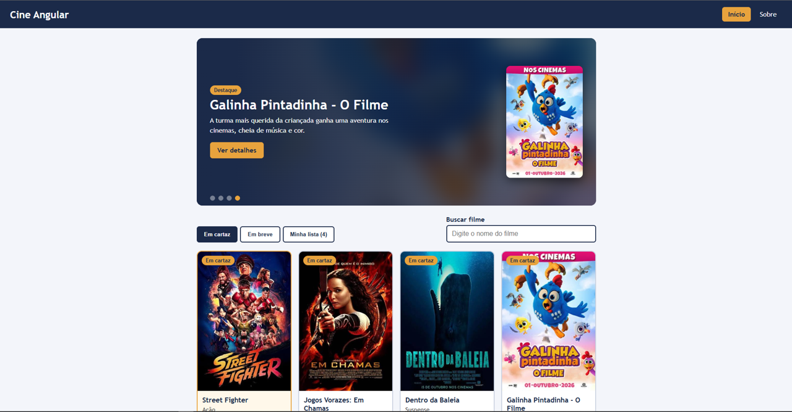
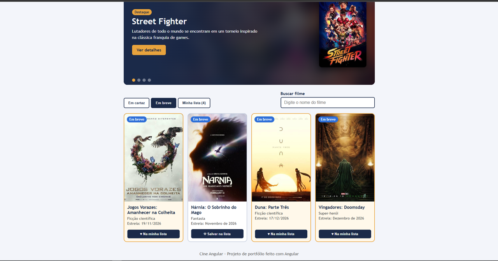
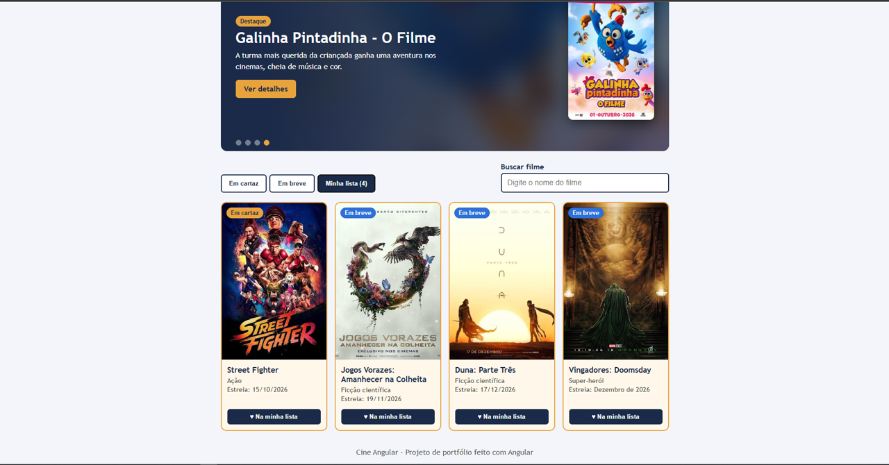
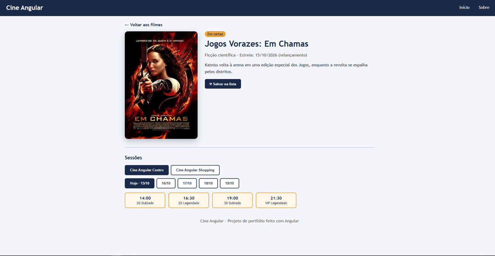
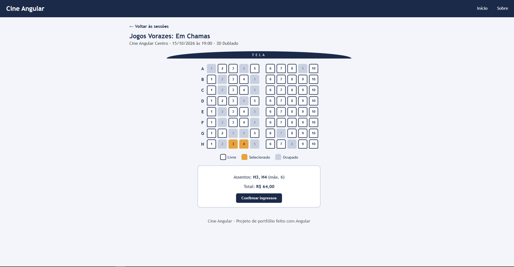
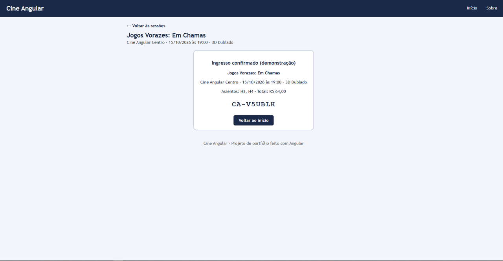

# 🎬 Cine Angular

Catálogo de filmes inspirado em sites de cinema, feito com **Angular 21**. Navegue pelos filmes em cartaz e próximas estreias, salve favoritos, escolha uma sessão e reserve assentos em um mapa interativo.

> Projeto de portfólio com fins educacionais. Cinemas, sessões e preços são **fictícios** e nenhuma compra real é feita.



## Funcionalidades

- **Banner de destaques** com troca automática e navegação por pontos
- **Abas** Em cartaz, Em breve e Minha lista, combinadas com **busca por nome**
- **Minha lista** salva no navegador (`localStorage`), mantida ao recarregar a página
- **Página do filme** por rota (`/filme/:id`) com sinopse e sessões
- **Sessões** por cinema, dia e horário, com formato (2D, 3D, VIP, dublado ou legendado)
- **Mapa de assentos** interativo (livre, selecionado e ocupado), com limite de 6 por compra e total calculado
- **Ingresso de demonstração** com código gerado ao confirmar
- Acessibilidade básica: rótulos nos campos, `aria-pressed`, `aria-label` nos assentos e foco visível

## Telas

| Em breve | Minha lista |
|---|---|
|  |  |

| Detalhes e sessões | Escolha de assentos |
|---|---|
|  |  |

| Ingresso confirmado |
|---|
|  |

## Tecnologias e conceitos

- Angular 21 com **componentes standalone**
- **Signals**, `computed` e `effect` para estado reativo
- Novo fluxo de controle do template: `@if`, `@for` e `@empty`
- **Roteamento** com parâmetros (`/filme/:id`) e query params
- Serviço injetável (`FilmesService`) para dados e favoritos
- `input()` e `output()` na comunicação entre componentes
- TypeScript e CSS puro, sem bibliotecas de UI

## Estrutura

```
src/app/
├── card-filme/          # card reutilizável de filme
├── pages/
│   ├── home/            # banner, abas, busca e grade
│   ├── detalhe/         # página do filme e sessões
│   ├── assentos/        # mapa de assentos e ingresso
│   └── sobre/
├── filme.ts             # interface Filme
├── filmes.service.ts    # dados e Minha lista (localStorage)
└── app.routes.ts        # rotas
```

## Como rodar

Requisitos: [Node.js](https://nodejs.org) e npm.

```bash
npm install
npm start
```

Abra http://localhost:4200/. Para gerar a versão de produção: `npm run build`.

## Próximos passos

- [ ] Consumir a API do TMDB (`HttpClient`) no lugar dos dados fixos
- [ ] Testes automatizados para o serviço e o mapa de assentos

## Créditos

Os pôsteres são imagens de divulgação dos filmes, usadas aqui apenas para fins educacionais. Os direitos pertencem aos respectivos estúdios e distribuidores. Este projeto não tem relação com nenhuma rede de cinemas.

## Autor

**Cauan Morária** · [GitHub](https://github.com/devmoraria) · [LinkedIn](https://www.linkedin.com/in/cauan-moraria)